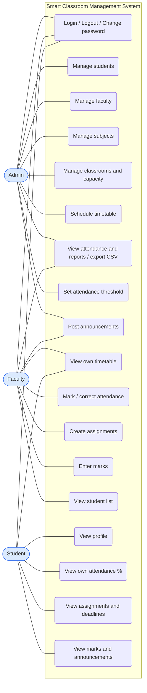
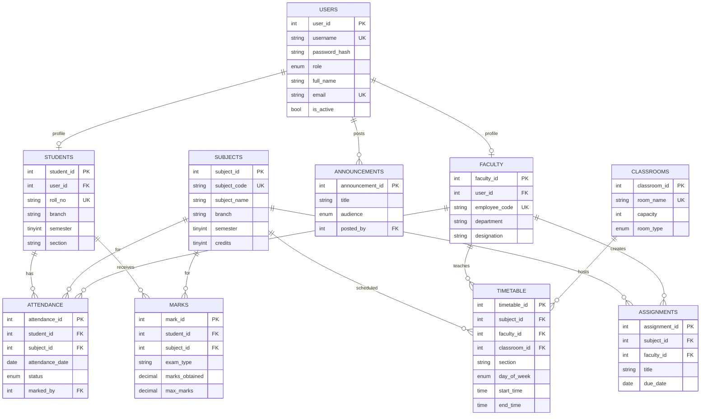

# Architecture

## 1. Layers

```
┌───────────────────────────────────────────────┐
│ UI layer        ui.*      Swing screens        │  no SQL, no business rules
├───────────────────────────────────────────────┤
│ Service layer   service.* business rules        │  validation, clash checks, permissions,
│                           transactions          │  percentages, hashing
├───────────────────────────────────────────────┤
│ DAO layer       dao.*     SQL only              │  PreparedStatement, maps rows to objects
├───────────────────────────────────────────────┤
│ MySQL           smart_classroom                 │
└───────────────────────────────────────────────┘
 model.* : plain objects passed between layers
 util.*  : DbConnection, PasswordUtil, Validator, CsvExporter, Session
```

**Rule:** a layer only talks to the layer directly below it. Example: "is this room double-booked?" is a rule, so it is
in `TimetableService`; the SQL that finds overlapping bookings is in `TimetableDao`; the screen only calls
`service.add(...)` and shows the message if an exception comes back.

**Error flow:** `SQLException` is caught in the DAO and wrapped as `DataAccessException`; rule violations throw
`ValidationException`, `ConflictException`, `AccessDeniedException` or `AuthenticationException`. All extend
`AppException`, so every screen catches one type and shows `e.getMessage()` in a dialog.

**Transactions:** `DbConnection.executeInTransaction(work)` opens a connection, turns off auto-commit, runs the work,
commits on success and rolls back on any error. Used for: creating a student or faculty (users row + profile row),
saving a whole class's attendance, and saving a whole class's marks.

## 2. Use-case diagram



## 3. Class diagram (main classes)

```mermaid
classDiagram
    class User {
        <<abstract>>
        -int userId
        -String username
        -String fullName
        -String email
        -Role role
        +getDashboardTitle()* String
        +getMenuItems()* List~String~
    }
    class Admin
    class Faculty {
        -int facultyId
        -String employeeCode
        -String department
        -String designation
    }
    class Student {
        -int studentId
        -String rollNo
        -String branch
        -int semester
        -String section
    }
    User <|-- Admin
    User <|-- Faculty
    User <|-- Student

    class TimetableEntry {
        -DayOfWeek dayOfWeek
        -LocalTime startTime
        -LocalTime endTime
        -String section
    }
    TimetableEntry o-- Subject
    TimetableEntry o-- Faculty
    TimetableEntry o-- Classroom

    class AttendanceRecord
    class AttendanceSummary {
        +calculatePercentage(attended,total)$ double
        +isBelowThreshold(t) boolean
    }
    class Assignment
    class Mark
    class Announcement

    class Dao~T~ {
        <<interface>>
        +findAll() List~T~
        +findById(id) Optional~T~
        +delete(id)
    }
    Dao <|.. StudentDao
    Dao <|.. FacultyDao
    Dao <|.. SubjectDao
    Dao <|.. ClassroomDao
    Dao <|.. TimetableDao
    Dao <|.. AssignmentDao
    Dao <|.. AnnouncementDao

    class AuthService
    class StudentService
    class TimetableService
    class AttendanceService
    class AssignmentService
    class MarkService
    class ReportService
    StudentService --> StudentDao
    StudentService --> UserDao
    TimetableService --> TimetableDao
    TimetableService --> StudentDao
    AttendanceService --> AttendanceDao
    AuthService --> UserDao

    class AppException
    AppException <|-- ValidationException
    AppException <|-- ConflictException
    AppException <|-- AuthenticationException
    AppException <|-- AccessDeniedException
    AppException <|-- DataAccessException

    class CrudPanel~T~ {
        <<abstract>>
        #loadItems() List~T~
        #toRow(T) Object[]
        #onAdd()
        #onEdit(T)
        #onDelete(T)
    }
    CrudPanel <|-- StudentPanel
    CrudPanel <|-- FacultyPanel
    CrudPanel <|-- SubjectPanel
    CrudPanel <|-- ClassroomPanel
    CrudPanel <|-- TimetablePanel
    CrudPanel <|-- AssignmentPanel
```



## 4. ER diagram


Plus a `settings` table (key/value) that stores the attendance threshold.

Key constraints: `UNIQUE(student_id, subject_id, attendance_date)` on attendance, `UNIQUE(student_id, subject_id,
exam_type)` on marks, `CHECK (start_time < end_time)`, `CHECK (capacity > 0)`, `CHECK (semester BETWEEN 1 AND 8)`,
`CHECK (marks_obtained <= max_marks)`, and foreign keys with `ON DELETE CASCADE` where the child cannot exist without
the parent (`attendance.marked_by` is deliberately *not* cascading, so a teacher with recorded attendance cannot be
deleted by accident).

## 5. Where each OOP concept is used (and why)

| Concept | Where | Why it is a real use, not decoration |
|---|---|---|
| Encapsulation | all `model` classes (private fields, getters/setters); `Classroom.setCapacity` rejects values <= 0; `AttendanceSummary` keeps the percentage rule | invalid state cannot be created; the rule lives next to the data |
| Inheritance | `User` -> `Admin`, `Faculty`, `Student` | the three really share id, username, name, email, role; subclasses add only their own fields |
| Polymorphism | `User.getMenuItems()` / `getDashboardTitle()` overridden per role; `DashboardFrame` builds the sidebar from them; `AuthService.login` returns a `User` that is really an Admin/Faculty/Student | no `if (role == ...)` chain for the menu |
| Abstraction | abstract `User`; generic `Dao<T>` interface; abstract `CrudPanel<T>` (template method: subclasses fill in `loadItems`, `toRow`, `onAdd`...) | six screens share one list/search/add/edit/delete implementation |
| Interfaces | `Dao<T>`, `Refreshable` (the dashboard refreshes any screen that implements it), `DbConnection.TransactionalWork`, `DbConnection.TransactionRunner` | decouple callers from implementations; `TransactionRunner` lets tests run without a database |
| Composition | `TimetableEntry` *has* a `Subject`, `Faculty` and `Classroom`; services *have* DAOs; `DashboardFrame` *has* its screens | "has-a" relationships |
| Exception handling | `AppException` hierarchy; `DataAccessException` wraps `SQLException` and exposes `isDuplicateKey()` | the UI never sees SQL errors, and a duplicate roll number becomes a friendly sentence |
| Collections | `List` (rows), `Map<Integer, AttendanceStatus>` (marks for a class), `Set<Integer>` (already-marked students), `TreeMap`/`EnumMap` (timetable grid), `LinkedHashMap` (menu to screen) | each is the natural structure for the job |
| Records / enums | `Role`, `AttendanceStatus` (knows whether it counts as attended), `UserDao.Credentials`, `ReportService.DashboardStats` | small immutable data carriers |
| Design decision | services are concrete classes (not interfaces) | tests inject fake DAOs through the constructor, so an extra service interface would add files without adding value |

## 6. v2 additions: leave requests, grade card and room booking

```
Student: My Leave ---------> LeaveService ------------> LeaveRequestDao ----> leave_requests
Admin / Faculty: Leave Requests (LeaveReviewPanel) -^

Student: Grade Card (GradeCardPanel) ---\
Admin / Faculty: Class Rankings ---------+--> GradeService --> MarkDao, SubjectDao, StudentDao (no new table)

Faculty: Room Booking (RoomBookingPanel + dialog) --\
Admin: Room Requests (RoomRequestsPanel) -----------+--> RoomBookingService --> RoomBookingDao -> room_bookings
                                                                           \--> TimetableDao (clash with weekly classes)
                                                                           \--> ClassroomDao (capacity)
```

New tables (`sql/schema.sql`, or `sql/upgrade_v2.sql` for an existing database):

```
leave_requests(leave_id PK, student_id FK, from_date, to_date, reason, status, reviewed_by FK users, review_remark, created_at)
room_bookings(booking_id PK, classroom_id FK, faculty_id FK, purpose, booking_date, start_time, end_time,
              expected_attendees, status, review_remark, created_at)
```

OOP notes: `RequestStatus` (enum) is shared by both request types; `GradeScale` (enum) holds the grading rule in one
place; `GradeCard.SubjectGrade` is a record; `RankingsPanel` and `LeaveReviewPanel` are reused by two roles; the
review/booking screens extend `CrudPanel<T>` and only supply `loadItems`, `toRow` and their own buttons;
`BarChartPanel` draws the chart with plain Java2D (no library).

